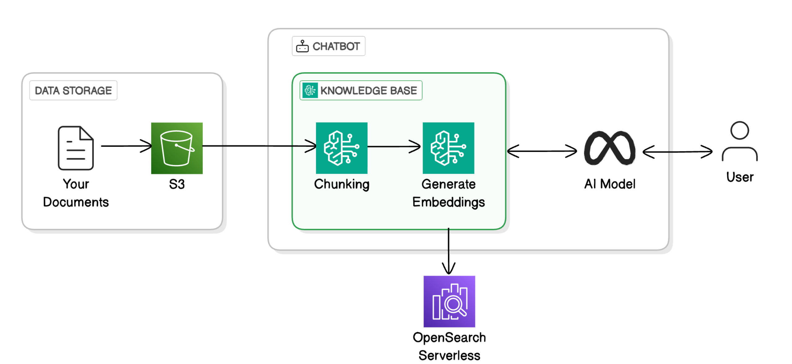

# Set Up a RAG Chatbot in Bedrock

**Project Link:** [View Project](http://learn.nextwork.org/projects/ai-rag-bedrock)

**Author:** Jyothesh Karnam  
**Email:** jyotheshkar@gmail.com

---

## Portfolio Scope

**Maturity:** Personal guided AWS learning lab. This repository contains a lab write-up, an architecture image and a PDF. It does not include application source code, infrastructure as code or an automated evaluation suite.

- [Local architecture diagram](architecture-complete.png)
- [Lab PDF](legendary-ai-rag-bedrock.pdf)
- [Evidence, design decisions and limitations](docs/PORTFOLIO_EVIDENCE.md)

The following notes describe the original exercise. Model availability, access steps and pricing must be checked against current AWS documentation before repeating it. No live endpoint, current deployment or benchmark is claimed here.

---

## Introducing Today's Project!

Retrieval Augmented Generation (RAG) retrieves information from a document source and adds it to the context used to generate a response. This lab explores that workflow with Amazon Bedrock; it does not train or fine-tune a model on the documents. See the [AWS explanation of how knowledge bases work](https://docs.aws.amazon.com/bedrock/latest/userguide/kb-how-it-works.html).

### Tools and concepts

Services I used in this project were Amazon Bedrock, S3, and OpenSearch Serverless. Key concepts I learnt include knowledge bases, requesting access to AI models, how chatbots generate responses (i.e. AI models + knowledge base), vector stores.

### Project reflection

This project took me approximately two hours including project demo time. The most challenging part was the error with my AI models (and understanding on-demand vs pre-provisioned inference). It was most rewarding to level up my chatbot’s responses!

I did this project today to learn more about Bedrock and RAG. This project definitely met my goals – awesome to learn both over a hands-on project!

---

## Understanding Amazon Bedrock

Amazon Bedrock is an AWS service that makes it easy to build generative AI applications. This is because Bedrock is like an AI model marketplace that lets us find, use an test models from different providers in a central place. I am using Bedrock in this project to create a knowledge base.
 

My Knowledge Base is connected to S3 because S3 is going to be the storage/source for my Knowledge Base's raw documents. S3 is AWS’s storage service, where you can store all kinds of objects (e.g. videos, documents, audio) in the same bucket.

In an S3 bucket, I uploaded the documents that will make up my chatbot’s knowledge. For the original lab, I placed the S3 bucket and knowledge base in the same AWS Region. Check the current service requirements before reproducing the setup.

---

## My Knowledge Base Setup

My Knowledge Base uses a vector store, which means a search engine/database that stores data based on their semantic meaning! When I query my Knowledge Base, OpenSearch will find the relevant chunks of data to the query, and pass it to Bedrock.

Embeddings are vector representations of the semantic meaning of a chunk of text. The lab notes identify Titan Text Embeddings v2 as the embedding model. No comparative accuracy, latency or cost benchmark is included in this repository.

Chunking splits documents into smaller pieces for retrieval. Chunk size and overlap affect which context is available across boundaries; their impact on answer quality must be measured. This repository does not provide a reproducible chunking configuration or an accuracy benchmark.

---

## AI Models

AI models are important for my chatbot because they’re the translator of my Knowledge Base’s search results into human-like text. Without AI models, my chatbot would only respond with chunks of text from my documents – which isn’t the best experience!

During the original exercise, I used the console model-access workflow. This is a historical lab observation, not a current setup instruction; model access and regional availability should be checked in the [current AWS documentation](https://docs.aws.amazon.com/bedrock/latest/userguide/knowledge-base.html).

---

## Syncing the Knowledge Base

Connecting the S3 data source was followed by an ingestion/sync step in the exercise. The notes below describe that historical workflow; they do not establish the current state of any AWS resource.

The sync process involves three key steps: Ingesting (i.e. Bedrock takes the data from S3), Processing (i.e. Bedrock chunks and embeds the data) and Storing (i.e. Bedrock stores the processed data in my vector store, OpenSearch Serverless).

---

## Testing My Chatbot

The original exercise reports an invocation error with Llama 3.1 8B and a switch to Llama 3.3 70B. This records the troubleshooting performed at the time; it does not assert current model availability or comparative efficiency.

The lab notes report a refusal for an out-of-scope question. A single example does not establish that the model is restricted to the supplied documents, that all answers are grounded, or that hallucinations are prevented. No systematic evaluation results are included.

I can also turn off the Generate Responses setting to see the raw chunks of data directly from my Knowledge Base. When I tested this, my chatbot gave a list of 5 paragraphs to answer a question, whereas the AI model will convert it to a sentence.

---

## Upgrading My Chatbot

In an extension, I explored the number of retrieved source chunks and the generation prompt. These are configuration choices to evaluate against representative questions; more retrieved text does not by itself establish a better answer.

I also added a custom prompt that tells my chatbot to always respond by mentioning skills that the student’s learnt, even if the student didn’t ask for it directly. I also gave context that the database contains documentation for projects.

The notes report a more detailed response after those adjustments. This is a qualitative observation, not a measured improvement in retrieval relevance, groundedness or answer quality.

---

---

