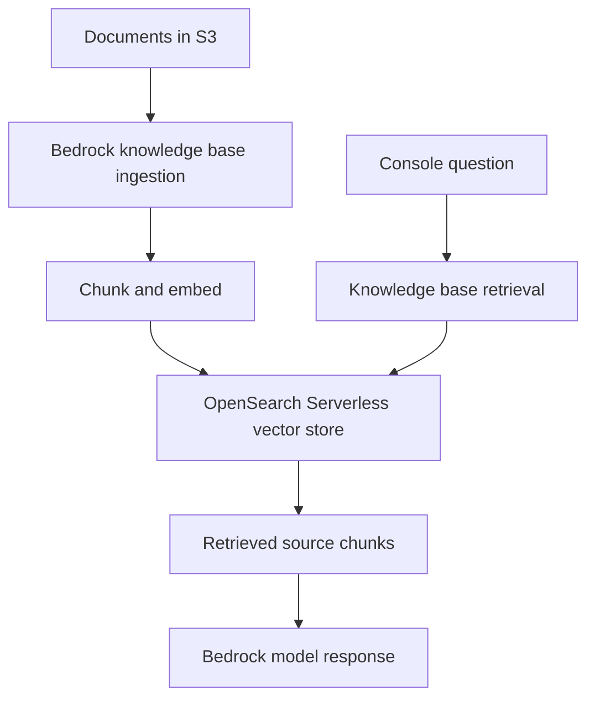
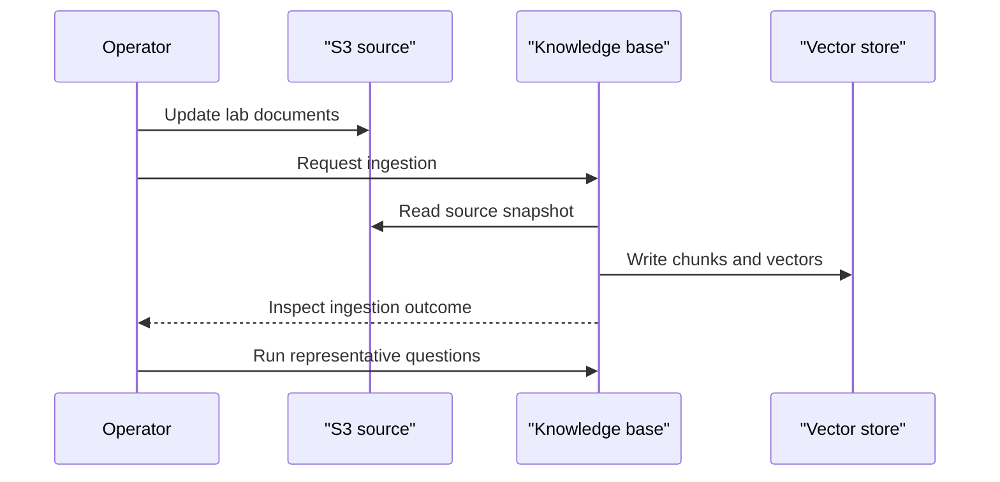

# Bedrock RAG learning lab: architecture and operational design

Reviewed 11 November 2026 against main `39b8a04038f7dd8a987226395f79b0cc33f9034c`. Maintenance documentation is AI-assisted. This repository preserves a guided AWS console lab: README, architecture image, PDF and evidence notes. It has no application implementation, infrastructure as code or automated evaluation suite. The following editable diagrams reconstruct the documented lab; they are not evidence of a currently running service.

## Documented ingestion and query paths

The historical notes identify Titan Text Embeddings v2 and a change of generation model after an invocation error. Current regional access, supported model identifiers and pricing must be checked before reproducing. No model is trained or fine-tuned by this ingestion path. The README's one out-of-scope refusal does not establish a grounding guarantee.

## Boundaries and engineering decisions

Document ingestion and interactive generation have separate failure modes. An updated S3 object is not evidence that ingestion succeeded. Preserve document identifiers and source version metadata so an answer can be traced to the indexed content. Retrieval count, chunking and prompts should be versioned together with evaluation questions. Model substitutions can change cost and answer behaviour; re-evaluate rather than assuming a larger model improves quality.

The lab contains no API authentication, tenant isolation, application retries, prompt-injection controls or redaction implementation. Treat document content as untrusted input in a future application. Enforce access to source documents before retrieval, and include only authorised chunks in generation context.

## Maintain and reproduce safely

Start with the [existing evidence notes](PORTFOLIO_EVIDENCE.md), [README](../README.md) and [architecture image](../architecture-complete.png). The PDF is a historical walkthrough. Inventory any independently owned lab resources and confirm service availability before replaying it; no resources were created or modified during this maintenance.

A reproducible next implementation needs explicit configuration and infrastructure code reviewed before provisioning, synthetic fixtures and an offline evaluation set. Verify ingestion counts/status, missing-document and stale-index behaviour, source citations, abstention for absent evidence, malformed input and provider timeouts. Record retrieval recall, groundedness, latency and usage from actual runs, with dataset/version details. No measurements are supplied here.

## Scaling design, not an implemented guarantee

Measure document volume and update frequency separately from question concurrency. Bound retrieval count, context size and generation tokens; apply request admission limits and per-user budgets. Use incremental, idempotent ingestion with observable failures rather than blindly reindexing everything. Add timeout/retry limits only for retry-safe operations, and capture throttling/cost signals without storing confidential prompts in logs. Capacity and recovery depend on the selected services, quotas and access policies; no load or recovery test has been run. Keep teardown steps and retention policies beside future infrastructure configuration.

